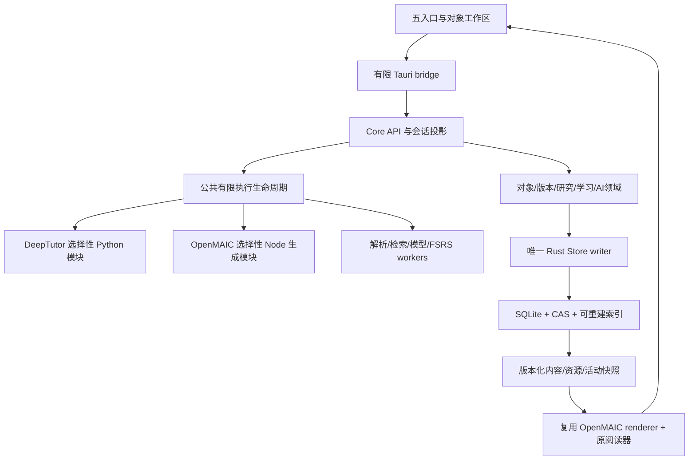

# AAOS 后端与学习供体审计（2026-11-12）

性质：本轮审计附件与实施提案，不改变 Owner 已批准规范，不是新增执行队列或产品验收。主审计基线：`main` / `157ee1db401bc4c101ad73309159eca7d09abc9a`，连同接手时未提交活动指针、唯一执行记录和 `aaos_openmaic_generation_staged_loop.py`。本文只新增报告；未改业务代码、依赖、数据库、模型配置、上游源码，未运行已有测试、构建、探针、应用或模型。

## 1. 结论

**保留正式 Tauri/React、Rust Core 单写者、SQLite/CAS 和受控 Python/Node worker；对学习业务、桥接消费者和执行生命周期做有力度的模块整合。** 当前主要矛盾已从“有没有教学后端”转为“后端候选如何成为可继续使用的学习内容”。DeepTutor 的出题、接纳、评分、反馈和 OpenMAIC 的大纲、slide、quiz、interactive 候选都已有真实 Core 代码。继续平均补适配器会增加维护面，却不一定让用户多完成一个任务。

这不意味着底座没有技术债：DeepTutor 出题的持久化幂等尚不等于执行幂等；语义检索按每次查询全量处理 accepted 知识，单个不合格条目可阻断整次查询；FSRS 已脱离写者，但同步子进程等待仍位于 async handler；课程编排集中在 3,000 多行 `courses.rs`，多个阶段的重复代码需要收敛。上述问题适合局部整合，不足以支持换数据库、引入全套 Agent Runtime 或搬入两个供体的完整服务器。

## 2. 范围、依据与状态分层

已读任务书正文与附录、根规则和入口、AUTHORITY 第 0 节、产品身份 V2.3、闭环 V3、活动指针相关控制、当前交接和唯一执行记录后继学习章节。目录盘点覆盖正式宿主、八个 Rust crate、worker、两供体与运行闭包；深入追踪下列核心链，完整上游树仅按固定身份、模块入口与选中源文件审查，未逐行审查 8,301 个上游文件。没有打开真实业务库，未重现运行时故障，未核验新的整包性能或真实教学效果。源码检查是本轮新观察；历史 PASS 是限定继承，不能相互替代。

| 层 | 实际拥有者、入口及证据 | 判断 |
|---|---|---|
| 正式宿主 | `src-tauri/src/main.rs:411` 复用 `desktop/src-tauri/src/backend.rs`，`:420` 复用 runtime；`:821` 的 `core_command` 在 blocking pool 内调用宿主 transport | `desktop/` 不是可以整目录删除的旧物；正式宿主复用部分必须保留 |
| UI/API 边界 | `src-tauri/src/core_bridge.rs:36` 有限 Operation；`crates/archeaxis-api/src/runtime/mod.rs:476` 起注册新教学路由 | 新 HTTP 路由并不自动进入正式 UI；新增 donor 生成/反馈路径在宿主枚举和前端业务消费者中缺席 |
| 业务 | `archeaxis-domain` 管 Document、Knowledge、Source、Anchor、AiAsset、课程、活动、attempt、grant、版本与条件；`archeaxis-api/runtime` 编排外部阶段 | 领域模型和状态已实际存在，不能以新架构名另造一套 |
| 写者 | `crates/archeaxis-store-sqlite/src/writer.rs:70` 默认容量 64；`:111` OS 文件锁；`:132` 单连接线程；`:155` 约束 callback 不等待 worker | 正式链中 DB 操作串行化有实现。它不是 OS 沙箱，也不是全盘所有旧脚本都不能写数据库的证明 |
| 存储 | `crates/archeaxis-store-sqlite/src/lib.rs:39` 起 Documents/versions/blocks；`:115` sources；`:140` transforms；`:148` anchors；`:155` knowledge；`:183` supersedes；`:335` provider activities/attempts | 原件、版本、活动、采用和掌握没有混成一个可变 blob；专用元数据仍有 schema 负担 |
| 保存 | `crates/archeaxis-api/src/documents.rs:175` 直接进入 `document::save_with_basis`；`domain/document.rs:364` 事务与 expected version | 普通保存不需要模型、网络核验或事实审批；保留这个优势 |
| 执行 | `archeaxis-application/src/executor`、`jobs.rs`、`attempts.rs`；runtime execution claim、job/machine journal | 生命周期已不少，宜共享基础执行语义，不能把人类学习 attempt 与后台执行 attempt 合成一种含糊状态 |
| 检索 | `domain/search.rs:41` 起 FTS5 + 增量 trigger；`runtime/semantic.rs:1` 明确 query-time ranking、无持久向量索引 | 本期先修索引与查询边界；不把旧 sqlite-vec 迁移记录当正式 Core 已用向量库 |
| 导出恢复 | `archeaxis-archive/src/lib.rs:11` 起 schema-specific FK-safe 表布局；`api/workspace_backup.rs`、宿主恢复路径 | 保留已有快照/恢复 fence，不搬进供体 DB；新增学习状态必须进入现有导出布局 |
| 安装 | `scripts/release/stage_backend_runtime.py:93` DeepTutor pin，`:138` 加载 OpenMAIC closure；`RUNTIME-CLOSURE.json` 12 worker/9 vendor 目录/694 文件 | 完整 upstream 与分发闭包不同。不能把整个上游树打进产品 |

## 3. 重要发现与取舍

### B-01：学习生成能力缺正式消费者（P1，代码事实）

场景：用户选择一份物理讲义，想生成讲解/题目、作答、反馈、下次续学。`runtime/mod.rs:476–549` 已有 question-turn、teaching-feedback、question-candidates/accept、scenes/generate、outlines/generate、generate-interactive、package-projection。宿主 Operation 仍以旧 practice import/grade 与 scene create 为主；这些新路由名称在 `src-tauri/src` 与 `frontend/src` 的搜索没有消费者命中。前端子审计还确认旧 practice-grade 枚举存在但业务调用缺失。

根因判断：后端按 donor 切片持续完成，产品学习会话尚未把切片编成一个可操作链。建议以“资料版本→学习会话→讲解/作答→反馈→复习/实践记录”连接既有接口；给每个阶段明确读回和继续入口。收益是已有投资真正可用；代价是有限桥接、UI 和学习会话关联工作。不采用则继续出现“Core 能做、安装后用户找不到”的交付落差。

### B-02：interactive 已能生成保存，仍不是可玩的课件（P1 产品缺口，既有设计边界）

`domain/course.rs:570–664` 派生 render contract；`:631` 明确 interactive HTML 不执行、不服务，`:647` 记录该原因。`runtime/courses.rs:1345` 分派 slide/quiz/interactive；真正的互动大纲路由已存在。2026-11-07 原始 staged 与安装态回执均包含 diagram 场景、`html_execution: NOT_PERFORMED`、`rendering_authorized:false`、`render.playable:false`，不能再说“没有 interactive/Core/打包”，也不能说“互动教学已可用”。

建议第一批完成可控 slide/quiz 学习舞台，直接评估已保留的 `@openmaic/renderer` 组件；interactive 下一片引入独立受限渲染面及清晰能力清单，保持旧候选可以只读。安全处理必须围绕这段要执行的 HTML 和资源，不为所有文档保存加审批。收益是把复杂呈现交给成熟组件；代价包括资源加载、消息协议、离线依赖和 accessibility。仅解除 `playable:false` 或把 HTML 塞进主 WebView 不能完成该任务。

### B-03：DeepTutor 出题目前是存储去重，不是进行中执行去重（P1，源码推断，未运行复现）

`domain/provider_question_turn.rs:334–369` 准备阶段查已有文档、材料权限与恢复 epoch，随后提交事务；没有该生成请求的 durable in-flight claim。`runtime/deeptutor_question_turn.rs:199` 再调用本地模型。`provider_question_turn.rs:595` 明写“两次并发请求可能都已通过准备”，最终只保留首个候选。由此推断，同一 create_request_id 在首个候选落盘前重复进入，可能发生两次推理，但只产生一份最终文档。现有“重复请求不重跑”的顺序回放证据不能证明并发单执行，也不能证明进程在模型完成后、落盘前中断可恢复。

建议复用 `runtime/execution_claim.rs:1–75` 的持久意图/已知失败/未知状态理念，做 provider generation 的小型公共执行记录，绑定 request digest、材料快照、restore epoch、阶段与结果。不要原样复用 machine 私有键空间；共享实现、不混淆业务类型。最终文档仍按原 ID 写入，既有候选无需迁移。新增验证只需并发同 ID、模型后崩溃、取消后迟到三类；本轮不跑。收益是避免重复等待/资源占用；不采用会让 UI 双击、超时重试与网络断连暴露此差异。

### B-04：语义检索的规模和故障范围过大（P1/P2，代码事实与性能推断分开）

`runtime/semantic.rs:41–50` 读取所有 current accepted Knowledge；`:244` 后逐批最多 16 条，每次查询重新调用 ranking；`:255` 附近对任意正文超过 8,192 字符返回整次 422，对任意 stale source binding 返回整次 409；末尾返回 `index_persisted:false`。这是确定的代码策略。随库增长会增加模型调用量和等待是推断，没有本轮耗时测量。一个不相关的过长条目阻断查询，是用户可感知的降级问题，不是“再加 RAG 框架”能自然解决的。

建议先保留 FTS5 作为离线首选，按有限候选与可分页 chunk/version 索引建立可重建语义缓存；不可排名项逐项解释，仍返回合法子集和 `PARTIAL`。若需要 sqlite-vec，作为 Rust Core 管理的派生索引，不开第二知识库。切换前保留现有 query-time 后备，并标明检索范围/截断，不静默改变召回。长期可接受的代价是索引版本失效与重建；不采用则库越大，检索越容易因全库一个例外而失效。

### B-05：FSRS 旧“阻塞写者”结论已过时；仍有 async 同步等待（P2）

`api/lib.rs:1128–1186` 已用短 writer snapshot→writer 外 `SchedulerClient.review`→短事务 CAS。因此不再把旧架构文档中的 writer 内同步调用作为现状。`domain/learning.rs:441` 还校验前一 FSRS 状态，防止依据变更后写入旧调度。

剩余源码风险在 `lib.rs:1160`、`:1253`：同步子进程调用直接位于 async handler，`application/scheduler.rs:664` 后是同步管道/等待。它不会持有 writer，却可能占用 Tokio worker 线程；多并发 review 或低核机器影响待测。第一步是 `spawn_blocking` + 有界并发，继续 py-fsrs，非立即迁移 fsrs-rs。迁移原生算法只有在实际部署成本/性能改善值得承担卡片状态、参数、版本兼容时再进行；现有调度证据无需重做。

### B-06：四消费者当前性已有底座，应统一呈现而非重建（保留与 P2 整合）

`knowledge.rs:540` 返回 current/superseded/not_current；`object_reference.rs:117` 让 Knowledge 保持不可变 ID，旁列当前性；`relation_projection.rs:29` 区分 resolved 与 current；`ai_asset.rs:321` 将知识当前性放入资产 packet；`learning.rs:860` 给复习卡原知识版本附 active；`course.rs` 的课程 binding 也按旧身份读回。

`domain/tests/currentness_cross_consumer.rs:183–236` 已有同次修订跨 reference/relations/asset/course 的断言；本轮只读测试代码，不把存在当执行 PASS。建议让研究、学习、AI 的检查器复用同一当前性说明，保留“可定位/历史/已撤回/已验证”的差别。不要新增另一个依赖图来替代已有关系投影，不自动将旧课程、旧回答和旧评测改指新版本。

### B-07：AI 知识侧不是只有登记，但产品使用证据须单独归属（保留与 P1 接线）

`domain/ai_asset.rs:15–68` 定义 memory/knowledge package/rule/skill/experience、candidate/adopted/withdrawn、适用范围、来源、到期、冲突与 revision；`runtime/colearning.rs:994–1212` 核 retest eligibility/纠正谱系/冻结上下文，实际执行后保存独立 retest receipt，明确结果由人比较，Core 不自动断言“纠正有效”。`runtime/execution_claim.rs` 阻止未知推理盲重发。现行源码已超过“审批登记”阶段。

建议 UI 从资产详情直接创建受范围约束的使用任务，显示本次实际采用版本→回答→失败/纠正→复测比较。先接现有 packet/grant/answer/correction/retest，不引入 MemOS/Graphiti 第二主库。跨应用自动修改 Agent 规则不是这些接口的默认行为。真实模型的完整“采用后改善”仍需专门证据，旧 J4 回答成功不能证明教学或 AI 学习改善。

### B-08：按场景拆编排，保留状态语义（P2 维护问题）

`runtime/courses.rs` 的 outline、interactive outline、slide、quiz、interactive 链集中超过 3,000 行。它们重复做 snapshot、admission、模型/worker stage、具名失败和 candidate commit；新类型容易需要跨 domain、runtime、worker、closure、宿主多处同步。建议拆成 `courses/{outline,scene,package}.rs`（拟议路径），共享有限 stage execution helper，保留具体类型 DTO/校验。以 typed provider descriptor 派生能力与路由投影，逐步替换人工重复登记；不要新增万能 workflow DSL。旧合同 major 原样兼容，先仅移动内部边界，不批量改已有文档 namespace。

## 4. 两供体的能力族融合矩阵

固定来源：DeepTutor 1.7.1（归档 SHA `9614f50c…`、Apache-2.0）；OpenMAIC 1.3.0（归档 SHA `7cea2a58…`、MIT）。完整源码在各自 `upstream/`，详见其中 README 与 SOURCE-MANIFEST。这里的固定版身份来自本地保留资料与源码，不表示本轮重新复算全部归档。当前上游新版由开源选型附件另行核对；本轮不自动升级。

下表“Core”代表代码与指定历史层级，不等于真实用户已能从正式 UI 完成。“已有证据”凡只引用执行记录的，均是历史记录级，原日志未读不得提升为原始回执核验。

### DeepTutor

| 能力族 / 保留模块 | AAOS 接线、存储与入口 | 已有证据 / 当前结论 | 融合建议与下一步 |
|---|---|---|---|
| 教学/解释：上游 `learning/teaching.py`、`learning/prompts.py`、mastery pipeline | `teaching_feedback_worker.py` 复用画像更新/教学提示规则；`runtime/deeptutor_teaching_feedback.rs` 存 feedback candidate Document；不是完整讲解过程 | 执行记录 2026-11-06 PR294/295 有真实 donor worker + stub 旅程；正式教学 UI 未接 | 保留规则 worker；从选定材料生成解释、例子与自我解释活动进入既有 TeachingRecord；不整搬 ChatOrchestrator |
| 阅读上下文：上游 `capabilities/reading/`、`reading/_grounding.py`、`study_guidance.py`、captions/references | AAOS 已有 Source/Anchor/material grant/material_question，未发现上述阅读模块完整接入 | 源码已保留；不能声称 immersive reading 已融入 | 优先抽取 grounding 与学习提示策略，适配现有 anchor/page/time，复用正式阅读器；不接 reading/store 第二持久层 |
| 题目生成：`agents/question/pipeline.py`、中英文 prompt | `question_turn_worker.py` capture/replay 原 `_quiz_one`；Core question-turn 调本地模型并存候选 Document | PR293 记录 runtime 测试；PR295 旅程 stub；完整探索/规划/agent loop 不在此切片 | 保留现有模块融合；补进行中执行去重、UI 出题/题目复核；不重写 parser |
| 题目准入：原 question normalizer + AAOS accept | `runtime/deeptutor_question_accept.rs` 显式人类答案键，模型解释可作为 reviewed draft；正式题目仍绑定固定版本 | PR296/297 的历史测试记录；已跨过“生成题无法评分”旧缺口 | 接一个复核面板，默认解释是模型草稿；不要让个人学习被迫先做复杂资产审批 |
| 作答/评分：`services/practice/answers.py` | `grade_worker.py`、`provider_learning.rs`、`provider_grade.rs`；活动、attempt、event、双 grant、dispatch、UNKNOWN、重启读回 | 既有 DeepTutor Core 旅程与安装形态历史；正式前端业务调用仍缺 | 直接复用；客观评分与自报/独立掌握分列；开放题不能把 null 当错误或正确 |
| 反馈/补学：原 teaching rules | 反馈档案每次生成新 Document，保存 current_message/updates/基准版本；没有直接写 FSRS/mastery | PR294 重启、冲突、缺 worker 等记录；literal quote match 不证明语义支持 | 将反馈 candidate 链到同一活动，允许“多给例子/回看先修”；不自动把偏好当掌握提升 |
| 学习路径：`learning/navigation.py`、`objective_relations.py`、`mastery.py` | 未见整套 mastery path 接线；AAOS 已有 learning/teaching/expression 与固定来源对象 | 完整源码保留，不是已集成路径产品 | 选择性复用先修/导航函数和教学行为，用 Core DTO 承载路径；不接 LearningStore |
| 复习：`learning/review_strategy.py` 与 scheduler | AAOS 现行 py-fsrs 有真实独立路线；DeepTutor 自有间隔模板不是同一算法/状态 | 不能把两套调度并列写入同一 card | 保留 py-fsrs 单调度权威；仅参考按目标调整活动的 UX，必要时显式迁移策略 |
| 多媒体/可视化：reading read-aloud、video_learning、visualize/manim | 源码保留；AAOS OCR/ASR/媒体 anchor 有自身实现；完整供体执行平台未接 | 不以存在源码推定 TTS/动画可用 | 优先把已有媒体/字幕接到学习舞台；动画输出作为 Course artifact，专业执行外置 |
| 恢复/导出 | donor candidate/readback 适配；Core Document/Archive 承载持久结果 | 不等于 DeepTutor 自有会话库完整迁移 | 保留 Core 版本和包格式，旧结果没有 donor 运行时也可读；不引入完整会话 archive |

### OpenMAIC

| 能力族 / 保留模块 | AAOS 接线、存储与入口 | 已有证据 / 当前结论 | 融合建议与下一步 |
|---|---|---|---|
| 课程 DSL/结构：`packages/@openmaic/dsl`，generation outline modules | `openmaic_outline.rs`/interactive_outline；大纲候选 Document，scenes 分开存；package-projection 只读集合概况 | Core 已接；PR308 后 interactive 大纲也可由本地模型路线生成 | 用固定 DSL+场景列表构成课程会话；无需引入上游 PostgreSQL |
| 普通大纲 | `outline-replay-worker.mjs` capture/replay + 本地 model relay | 执行记录 4303 有真实 LM Studio `qwen2.5-vl-7b-instruct` 生成两大纲并重启回读；不是整课程质量 | 保留；用户目标/基础/材料应由 UI 提供，避免默认课例 |
| slide 内容 | prompt/reply/normalize worker + `domain/openmaic_slide.rs` + scene builder | 真实 Node+stub 与安装 Core 回执已有；真实本地模型曾被 8192 context 拒绝 | 保留原模块，增加请求前 token/context 预估与具名处理；不改全局模型配置 |
| quiz | quiz replay + `openmaic_quiz.rs`；存惰性题目场景 | 安装 Core 原始回执有题目和 speech，但未执行/评分 | 与 AAOS activity/attempt 关联；不要另造 quiz 成绩库 |
| 教学讲解动作 | slide-actions/quiz-actions replay + 两个 actions domain；支持受限 speech、spotlight 等 | 安装回执 slide 2 动作、quiz 1 动作；`action_execution:NOT_PERFORMED` | 复用 renderer 的几何/spotlight；文本朗读/讲解时间线另设消费边界，动作失败仍可读内容 |
| slide renderer | 上游 `@openmaic/renderer` 0.2.0 导出 SlideCanvas、Provider、Highlight/Spotlight/Laser/Zoom；MIT，字体另清单 | 完整源码存在，但不是现有正式 renderer 已接；peer React≥18/Motion≥11/Tailwind≥4，ECharts/Shiki optional | 首选组件融合；按使用元素选择依赖，避免照搬整个 Next shell；对未知元素列损失与原始保存 |
| interactive/五类 widget | prompt/normalize/interactive-outline worker；Core capture→model→normalize→scene 保存 | 694 文件闭包；11-07 staged 与安装 Core diagram 回执；playable=false；当前 HEAD code/game 字段有后继差异 | 第一批先展示安全候选预览/不可播放原因；后续受控 renderer 才解锁执行。procedural-skill/PBL 保留不准入，不伪报已实现 |
| 媒体/播放 | 上游 renderer/媒体生成 snippets 保留；AAOS 尚非完整课程媒体资产管理与时间线 | 当前 candidate 的来源绑定/正文保存不证明远程媒体本地化、离线播放或音视频同步 | 接 Core CAS 媒体与来源/time anchor，明确网络资源引用和缺资源降级；不用生成服务作必选前置 |
| 导出/恢复/版本 | 场景 v2 candidate 在 Document 持久化；未知 shape 保全、读回校验；OpenMAIC package projection 非真正课程打包 | 原始回执重启后 7 次模型调用保持 7 次；安装时未跑 Tauri UI | 课程包用已存场景快照/资源引用组装，接现有 Archive；player 状态按课程版本保留，未知 renderer 只读 |
| 上游整个产品外壳、Agent、storage | 只读 upstream，不是 AAOS 产品真值 | 没有理由用两套学习服务覆盖同一 Source/Knowledge/AI 生命周期 | 退出当前运行候选，留作行为与迁移参考。若将来独立教学服务收益显著，可通过明确外部连接，仍不双写 |

融合程度主推荐：**成熟纯模块/renderer 直接融合，生成与解析保留受控 worker，业务持久化统一回 Core。** 纯薄 API 代理成本低但会留下两个产品和两份状态；整体搬入成熟外壳虽能快速获得课程体验，却要重新补 AAOS 来源/AI资产/离线/恢复，不适合本阶段。只重写算法则浪费已保留的高质量模块。当前固定版继续用，针对能证明命中本地模块的新版修复选择性回移，先保留 pinned 元数据与旧结果 reader。

## 5. 证据继承与版本差异

| 能力 | 证据位置 / 版本 | 本轮使用方式与限制 |
|---|---|---|
| OpenMAIC staged slide/quiz/diagram | `.project-local/runs/be268a2d33/openmaic-staged-20261107/artifacts/openmaic-staged.json`（已读原始 JSON） | `ok:true`，7 次 stub 模型、重启仍 7；只继承生成候选/固定回读，不继承真实模型质量、动作执行或 UI |
| OpenMAIC 安装 Core 同切片 | `.project-local/install-acceptance-20261107/openmaic-installed.json`（已读）；Core SHA `c569b40a92399033da2600b7d01d4bdf50f387e7ca718d8c93158f5e4c2a46fb`；Node `ba4e6d11…`；执行记录绑定 source `140cfb42` | `INSTALLED_RUNTIME_REAL_CORE_REAL_NODE_SYNTHETIC_LOOPBACK_MODEL`；7→7、HTML 未执行。不是完整 Windows UI 旅程或 Owner 接受 |
| 当前 HEAD 差异 | `git diff 140cfb42..HEAD` 涉及 openmaic_interactive/outline、interactive-outline worker/runner、closure 与测试 | PR309 code.challengeType、game.challenge/playerControls 变化不由旧 diagram 安装回执证明。旧切片证据仍保留；未来仅新增字段、闭包 identity 和对应 code/game 情形定向验证 |
| dirty probe | `scripts/probes/aaos_openmaic_generation_staged_loop.py` 接手时已有 interactive 生成/回放断言补丁 | 原始回执使用了未提交探针新增链；不能说它由原 source SHA 中原样脚本产生，必须连同 patch 归属继承 |
| DeepTutor 出题/反馈/接纳 | `api/tests/deeptutor_question_turn_runtime.rs`、`deeptutor_teaching_feedback_runtime.rs`、`deeptutor_question_accept_runtime.rs`；执行记录 PR293–297 | 代码可确认消费者与断言；结果采用记录级限定继承。stub 与真实 donor 区分；没有原始日志的条目不提升为本轮验证 PASS |
| AI纠正/复测与 X8 | `api/tests/machine_correction_loop.rs`；`domain/tests/currentness_cross_consumer.rs` | 已有测试覆盖意图与源码逻辑，不重跑。全 UI 同候选/跨版本恢复效果仍另验 |
| 本地模型真实大纲 | 执行记录 4296–4303；`api/tests/openmaic_outline_real_model_runtime.rs` | 继承当次真实模型大纲与重启记录；未读其原始日志，不把记录称本轮模型运行 |
| 真实 slide 模型失败 | 执行记录 4319–4321；`openmaic_slide_real_model_runtime.rs` | 保留 prompt 约 9496 tokens、模型当时 8192 context 的已有失败；不重试、不擅改模型；后继大 context 接入才触发最小补验 |
| Windows staging 4 例旧失败 | 执行记录 4384 后 staging 与 4483 的 clean HEAD 对照 | 不能抹去或算作本轮失败；与后继真实 staged/安装成功是不同范围的证据 |
| FSRS | `api/lib.rs:1128` 后继代码；现有 learning schedule/review tests | “writer 内等待”结论被源码替代；本轮没有性能数据，不证明高并发性能 |

本轮首次执行仅为有界文件/源码读取、调用追踪、Git diff、原始回执 JSON 读取和报告写入；**没有重跑任何已有测试/实验**。命令中一次 `rg` scoop shim 启动失败、一次 PowerShell 路径表达式解析错误都只影响查找，随后用 `git grep`/显式路径读取完成，不构成产品失败。

## 6. 首批前后端配对实施任务（建议，不是本轮已实施）

任务 ID 只作为本审计定位，后继应映射既有 INT/CL/J/X 任务记录，不开第二进度台账。

与综合报告任务定位对应：BK-1 → T1；BK-2 → T2；BK-3 → T3；BK-4 → T4（引用/画布/X8）及 T5（AI资产使用体验）；BK-5 → T7；BK-6 → T6。以综合报告作为第一批任务总入口。

| 建议任务 / 用户完成结果 | 具体改动与复用 | 依赖、回退与验证增量 |
|---|---|---|
| BK-1 学习会话接线：从资料直接生成讲解/题目并继续上次活动（CL05/J5/X7） | 前端学习入口 + `src-tauri/src/core_bridge.rs` + generated client；后端复用 question-turn/accept/feedback、provider activity/attempt、course/TeachingRecord。加有限 session projection 关联现有对象/version，不复制正文到新库 | 先确认对象 DTO；旧路由保留。继承 donor/Core 回执，仅新增桥接路由、同材料版本连续旅程、取消/重启续做、未知结果读回；UI 的可操作验收不能借 Core PASS |
| BK-2 课程呈现：用户能看含图表/公式/讲解的真实 slide，quiz 作答入现有学习记录（X3/X4/X7） | 选择性并入上游 `renderer` + `dsl/geometry`；Core 提供 course bundle projection/资源引用；学习状态记录 scene/version/position，quiz 映射现有 attempt；保留旧文本/未知只读 renderer | 依赖 BK-1；没有 HTML 执行授权时降级。增量检查 renderer 支持元素、字体许可/离线资源、quiz 事件重复、重启位置；不重跑旧全模型旅程 |
| BK-3 稳定生成：同请求不会因重复点击重新推理（CL01/X5） | 在 provider generation 准备/模型/提交间复用 claim 基础实现；持久阶段、确定失败/UNKNOWN、取消与 restore epoch；拆 `courses.rs` 的公共阶段，保留具体 DTO | 现有结果 ID 不变，旧未带 claim 文档只读兼容。继承顺序 duplicate 测试；新增并发同ID、进程中断与迟到；实现失败可退回旧入口但不要承诺新单执行语义 |
| BK-4 知识更新后四入口一致提示，AI资产可用后纠正复测（J2/J4/X8） | 前端检查器/AI详情链接 packet→answer→correction→retest；后端复用 currentness/reference/asset_context_grant/colearning，增加一致投影字段而不改旧引用 ID | 依赖统一对象状态；保留旧版本阅读。继承 existing cross-consumer/machine correction 测试；仅新UI消费者、修订后读回与撤回后拒绝接入验证 |
| BK-5 搜索和保存不被学习作业拖慢（CL01/07） | 首先 FSRS 放 blocking pool；FTS 候选/分页与 per-item 部分失败；后续可重建 embedding cache，明确 model/version/chunk 身份；不先引 LightRAG/Graphiti | 独立于视觉；查询回退到 FTS。新增一个过长条目不阻塞其余查询、慢 scheduler 普通保存继续；大库性能实验仅在功能实现改变后以明确样本启动 |
| BK-6 同一候选交付闭包：装好后新教学入口可用（CL07/J6） | staging 与 finite descriptor 自动派生 capability/UI投影；安装包清楚启用 Node/选中worker；延续现有 pinned closure 和 runtime manifest | BK-1/2/3 后执行；本轮不重跑。增量只验新宿主入口+新renderer+变更字段/资源，已有完全相同底座证据继承；旧安装候选/数据保全作回退 |

随后补齐：DeepTutor 阅读 grounding/先修导航、interactive 受控 player、课程媒体离线资源、研究比较修订与学习活动的就地连接；原 PBL/procedural-skill、动画仿真/3D/VR/AR 保留后期接入位置，不按“这次没接”删除 required/long-term 身份。专业实践 L0 文字回记先复用 expression/teaching 和现有资料引用，不要求 MCP 或作品上传。

立即停止重复投入：再实现题目 parser/grader；另做 slide canvas；为 UI 重开第二套课程库；重复“只有评分/只有文本slide”的旧审计；把每一个 donor 阶段包成 MCP；全量搬入两套上游 runtime/storage；未触及问题就重跑旧旅程。现有完整供体源码留作只读更新与对照资产，不因不运行而删掉。

## 7. 目标模块图与迁移顺序

迁移按“加消费者→共用投影→提取生命周期→退役重复入口”推进。先不改持久 namespace，保留新旧 reader；新增课程会话只引用既有 Document/Source/Knowledge 与活动 ID。renderer 拆包引入，回退到原始内容/文本与明确不支持报告。共享执行基础稳定后再删除重复内部分支，原回执保持原 schema，不倒签新状态。任何新增持久字段都进入原导出/恢复布局并给旧包默认值；不以 alias 重命名覆盖旧身份。

架构推荐改变条件：若现有 Tauri 宿主在明确目标设备与新学习 UI 上持续无法满足渲染/资源约束，而独立教学壳能在不双写、不破坏离线/AI资产/恢复的情况下证明更低成本，再考虑将课程舞台独立化；若单写者实际测量成为主要瓶颈，先把重计算/长读移出 callback 并优化投影，而不是无证据迁 PostgreSQL。当前已有的代码与回执支持局部整合，没有支持全仓重写。
