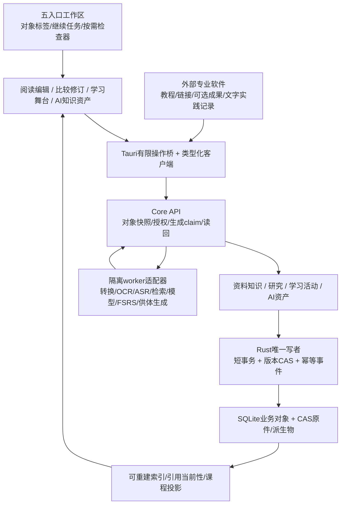

# AAOS 全面审计、产品重思与架构推荐

日期：2026-11-12（Asia/Shanghai）。审计对象：`main@157ee1db401bc4c101ad73309159eca7d09abc9a` 与接手时已有的三处未提交修改。**性质：本轮审计与后续实施提案；不是新的产品权威、执行队列、产品验收或发布声明。**

**推荐：保留 Tauri/React、Rust Core 单写者、SQLite/CAS 与隔离 workers，在现有栈内重构学习工作区和消费者接线，让资料→讲解→练习→反馈→复习，以及 AI 知识→使用→纠正→复测成为可续做的产品旅程。** 当前最大投资回报来自把已有能力组成可用流程；进一步引入完整知识平台不能直接解决这个问题。

## 1. 交付导航与事实边界

本报告与三个专题附录共同构成一份综合审计，避免把大量代码证据重复粘贴。附件正文及附录 A—D 共529行已完整读取；附件中的预调研是待核线索，授权来自本次用户请求。正文要求的五类交付对应如下：

|交付|位置|用途|
|---|---|---|
|综合判断、架构路线、首批任务|本文件|决策与下一轮执行入口|
|前端详细分析、六个代表视图、可复制 STITCH 提示词|[前端附录](AAOS-AUDIT-20261112-FRONTEND.md)|页面职责、交互、视觉与代码接缝|
|后端真实链路、两供体能力族融合矩阵|[后端附录](AAOS-AUDIT-20261112-BACKEND.md)|合同、存储、worker、安装与维护取舍|
|开源选型及实际登记变更|[开源附录](AAOS-AUDIT-20261112-OSS.md)|官方核对来源、角色/许可/版本/退出方式|
|能力和链路覆盖|[229行覆盖矩阵](AAOS-AUDIT-20261112-COVERAGE.csv)|186细目＋22职责＋CL7/J6/X8，保留身份|
|已有结果继承与最小补验|[证据继承表](AAOS-AUDIT-20261112-EVIDENCE.md)|九份原始回执、变化影响、历史失败与未证项|
|来源与提案登记|[本轮 intake](../workspace/intake/20261112-local-audit/README.md)|说明本轮写集和授权，不更改规范|

审查采用有边界的全景覆盖：正式宿主 `frontend/`、`src-tauri/`，`crates/` 的 API/application/domain/storage，`services/python-workers/`、两教学供体的适配器与必要上游切片，复用的 `desktop/`，`scripts/release/` 与 CI 路由，当前合同、格式/互通矩阵和开源登记。受版本控制的范围清点包括 frontend/src 551文件、crates 447文件、desktop 33文件、src-tauri/src 6文件；**这是范围清点，不是逐文件逐行审阅数量**。深入路径和行号见两专题附录。

没有逐字重读两套上游全镜像、所有历史包、所有测试或生成资源；没有启动产品、运行模型、安装/构建、重跑测试、制作新截图、调用付费服务、改真实库、跨项目写入或提交推送。未做当前运行态可用性、帧率、内存、吞吐量和真实学习效果测量。因此 UX问题分为“源码确定的入口/交互限制”和“待实际用户验证的体验推断”，没有声称做了本轮可用性实验。

### 1.1 当前规范、历史和提案

|材料|本轮身份与处理|
|---|---|
|AUTHORITY 第0节、PRODUCT_IDENTITY_V2.3、CLOSED_LOOP_DEFINITION V3|现行定义；人的学习、AI知识转化及全部required仍保留|
|活动指针 owner_scope_current/execution_control/permission_recovery_current/allowance_guard/active_progress|包含历史事件与后继恢复；不把早期暂停或额度观测解释成本轮审计禁止。监控不恢复|
|Owner决定 SUP-030/031/034|五入口、AI知识非上下文管理、完整供体源码与逐能力融入继续约束；本轮可提出架构取舍但不暗中取消目标|
|唯一执行记录末段及三处 dirty|当前事实线索；保护原字节；原始回执读取后分别继承，不覆盖原失败|
|附件 A 远端 d867109c|历史预调研，当前本地更新到157ee1db；不拉取/重置/覆盖|
|R6 186映射、22职责冻结表、37平台矩阵|保留身份与缺口；旧“未做”可被后继证据替代，旧PASS不能覆盖新行为|
|本轮报告、T0—T7与L1|提案索引，不是第二执行队列；实施时映射回UF/INT/CL/J/X与唯一执行记录|

接手三处修改：`docs/current/AAOS-ACTIVE-EXECUTION.json`、`docs/current/AAOS-UI-FIRST-EXECUTION-20261009.md`、`scripts/probes/aaos_openmaic_generation_staged_loop.py`。原始文件摘要保存在本地审计 baseline；本轮不修改它们。remote 显示 SSH origin 指向 DTALEX66/ArcheAxis-Knowledge-OS；未执行网络 Git 操作或宣称远端同步。

## 2. 用户为什么持续使用

AAOS 最有价值的不是“同时拥有许多工具入口”，而是把一次学习或知识修正保留下来，使下一次能从上次的对象、问题和版本继续。建议围绕三种重复发生的个人任务组织产品：

1. **理解一份材料**：导入统计学 PDF/访谈音频→回到页码或时间点→把疑点和解释放在旁边→形成笔记或知识→下次继续。
2. **学会并应用**：选择生物机制材料和学习目标→有内容的讲解/图示→无提示复述或练习→反馈补学→安排复习→在外部做实验/工作，回来写文字记录。看完、答对、自报完成、独立掌握是四种状态。
3. **让 AI 少犯同一种错**：从一次采购分析或研究工作中选取可复用经验→记录适用/禁用条件→有范围采用→任务实际使用→纠正失效建议→独立新问题复测。无需搬入外部完整会话，也不自动改 Agent 配置。

三个旅程共用 Source/Document/Knowledge/固定版本与引用；同一段材料不应该为“研究、课程、AI资产”各导入一份。课程、研究记录和AI资产保留自己的业务身份，通过引用连接原材料。用户只需理解“正在处理什么、哪里还不确定、下次从哪里继续”。

### 2.1 本轮关键发现

|优先级/发现|事实或推断及证据|用户影响、根因与取舍|
|---|---|---|
|高：教学后端与正式宿主消费者断开|源码事实。DeepTutor出题/接纳/教学反馈与OpenMAIC生成已到Core；ImportedCoursePanel仍以manifest、测验、文本幻灯片为主。见前后端附录|不能直接从材料连续进入讲解与反馈。优先补有限桥接及活动编排，不另写生成引擎|
|高：生成最终幂等不等于进行中只执行一次|源码推断。`provider_question_turn.rs:334` prepare未落持久claim，`:595`承认并发请求可同时通过prepare；模型执行在两事务之间|并发重试可能额外推理/等待，但未证明数据库重复对象。复用执行claim，保留UNKNOWN，未来做新并发反例|
|高：AI知识能力被上下文入口遮住|源码事实＋体验推断。`uiPages.ts:20,35`及CanonicalControlledAiSpace默认上下文；已有真实asset/use/correction/retest实现|改默认入口和任务串接，不重建AI记忆OS，不误报“只有审批”|
|高：课程候选已生成但不是可播放课程|原回执事实。E08/E09七次合成模型调用，重启无额外调用，interactive `playable=false`|优先借用供体renderer，保留原件和未知类型退路；不能靠改布尔值宣布可播放|
|中：画布有内容但来源定位粒度不够|源码事实。expression节点主要text/media、引用在板级；具体证据见前端附录|知识组织难回到原段/时间点。先扩节点引用与返回路径；无需马上换成另一套画布|
|中：五入口规范尚未完整落实|源码事实。`presentation/uiPages.ts:35-46`为六日常＋两个固定入口，22历史ID仍在|把入口归并到五场景，22 ID继续可路由；能力目录移入按需工具，不克隆22页面|
|中：语义检索扩展成本与故障耦合|源码推断。`runtime/semantic.rs`快照全部accepted知识、分批ranking、过长/旧来源导致整次拒绝|先让局部坏条目不拖垮检索，并用已有全文召回缩小范围；性能没测，不编造毫秒或阈值|
|中：开源登记与消费者显示滞后|事实。DeepTutor旧版/旧桥接描述、OpenMAIC及向量索引身份需对账，详见开源附录|更新已有池和派生目录，保留固定历史；不能靠旧登记断言新实现不存在|
|中：安装Core通过不覆盖当前字段或UI|原回执与Git差异事实。140cfb42候选之后PR309改变code/game准入和闭包|继承diagram已测切片；未来只补新字段/renderer/宿主变化，不重跑旧全链|
|已排除的旧问题：FSRS占住写者|当前源码反证。`archeaxis-api/src/lib.rs:1128-1170`为snapshot→writer外计算→CAS提交|不再派一次“移出writer”任务；是否更换为fsrs-rs另以真实收益与兼容性决定|

等级是本轮实施优先级，不是安全严重性评级。高优先级也不意味着已经授权生产修改。

## 3. 三条架构路线与明确推荐

|比较|A 沿现有架构逐点接线|B 现有栈内重构模块与工作区（主推荐）|C 调整产品基础/较大重构|
|---|---|---|---|
|可执行做法|逐个补Tauri操作，沿当前页面加入生成/反馈按钮|保持底座，按一条学习活动重组壳/课程呈现/生成claim/对象引用|以OpenMAIC完整课程壳或其他成熟知识平台承载学习域，AAOS成为对象服务/连接层|
|直接收益|最短接通单功能；回退最小|降低跨页复制，形成连续教学和AI知识旅程|成熟课堂、复杂互动与媒体体验可整块借用|
|主要弱点|当前页面分散和候选文档堆积继续增长；每个新provider增加按钮与状态|需要定义活动/场景/attempt关系及迁移兼容；重构边界必须保持有限|两套生命周期/鉴权/资源路径与持久化容易并存；离线桌面打包更复杂|
|旧成果利用|高|高：保留writer、SQLite/CAS、导入、恢复、grant、评分和供体算法|中：可留对象服务，但现有UI/宿主/恢复验收大量失去直接适用性|
|人的学习/AI侧|逐点增强，连续体验弱|两侧共用引用/版本；教学组件和AI资产各自有明确流程|课堂可能更完整；AI资产治理仍需自行接线，不随壳自动获得|
|数据保留|无需大迁移|先增加投影和版本化局部合同；旧Document/course照读，选择性迁移可撤销|必须建立完整对象ID/引用/权限/导出迁移；不能同时开放两库写入|
|运行维护|短期小，长期重复状态较多|中等；三运行边界维持，减少页面/队列重复|高；若整站引入Node服务、浏览器存储或第二数据库，需重新审查一致性|
|许可依赖|现有组合|优先已有MIT/Apache/BSD模块，具体拿取范围见开源附录|平台及子模块许可/商业边界需逐项确定；没有“API独立就自动无义务”结论|
|规模估算|小到中，多为接线但每个入口持续付维护成本|中，T1/T2为主要工程量，T0/T3/T4/T5可并行有限实施|大，迁移/离线/生命周期比界面移植更难估计|

估算只表达相对工作量，假设继续单用户Windows/Tauri、既有接口可复用、没有真实库迁移；没有工期承诺。

**选择 B，并在 renderer 层采用 C 的局部组件复用。** A可以承担T1最初桥接切片，但不作为完整产品路线；C的整壳替换目前没有证据表明能省去对象、grant、学习状态、恢复接线，反而引入新主库风险。

改变推荐的触发事实：供体独立renderer无法在现有WebView2运行且改造成本显著高于完整外部课堂；大量实际课程只能依赖完整独立服务；真实规模证明当前SQLite单写者而非业务组织/worker调用成为瓶颈；或Owner明确把协作/服务端多用户设为当前核心。届时针对子域重评C，不能仅因上游版本更新就换基础。

### 3.1 目标模块图（提案）

避免把Diagram误读为新增总调度器：API层复用现有execution_claim、learning/event与jobs；“课程投影”是既存文档/场景的读模型，不另建LMS业务库。供应商的解释、评分、生成结果是受版本约束的派生内容，不直接更新掌握度或替用户认可知识。SUP-034的完整能力逐项融入目标保留；PBL/procedural-skill等“当前未准入”只描述实现状态，报告中的先后顺序不是Owner批准延期或永久排除。

### 3.2 保留、融合、简化、替换与退出

|对象|决定|迁移与回退、不做的后果|
|---|---|---|
|Tauri/React + Core writer + SQLite/CAS|保留|不移动业务库，旧客户端/合同可读；重写会丢失现有一致性和恢复投资|
|frontend与desktop复用模块|明确单一实现拥有者，逐次消除跨目录不清晰处|先re-export/兼容导入再收拢；不因目录名直接删除desktop|
|Tiptap/PDF.js/Dockview/Radix|保留并统一状态/交互|固定默认工作区，保留有效偏好；不新增第二套编辑器/Dock|
|DeepTutor|直接融合辅导/出题/反馈适用模块，保留隔离执行|沿固定1.7.1和现有worker，按模块补完整能力覆盖；旧Python业务写桥退出正式链，不复活|
|OpenMAIC|保留生成worker，重点并入DSL/renderer/教学组件|按现有固定源码实现局部组件适配；完整上游镜像保留，不同时运行第二套产品与数据库|
|学习页面、教学需求/方案/交付|融合成同活动的局部阶段|历史page ID兼容，数据不复制；不合并则用户持续搬运材料与上下文|
|候选Document与学习记录|保留对象，补关联投影和可见状态|候选不是课程发布/掌握；对旧候选按schema读，不批量改写正文|
|生成编排、评分claim、普通jobs|复用现有claim语义，减少复制代码|保留各自业务终态和恢复边界，不强塞万能状态机|
|知识画布/关系图/学习路径|共享引用，保留三种视图职责|不将曲线/坐标当事实或先修关系；先扩节点引用，必要时再换renderer|
|全文/语义检索|全文保留；语义局部改造|将来有测量支持再用派生sqlite-vec索引；无默认LightRAG+图DB+记忆OS叠加|
|Avalonia与legacy Python|恢复/行为供体，退出当前开发目标|保留来源和迁移资料，不删恢复资产；旧调用不能赋予新Core集成资格|
|专业制作、CAD/3D/科研执行|外部连接/人工回记|可用图片/PDF等导出内容和链接，文字回记独立；不造专业编辑器|
|动画/仿真/空间/VR|分期保留L1落点|输出绑定课程场景与来源/参数版本；尚无体验证据不写“已支持”|

## 4. 推荐前端结构与三条连续链路

前端详细现状、代表视图、组件清单、响应状态与 STITCH 原文见[前端附录](AAOS-AUDIT-20261112-FRONTEND.md)，它是本报告的设计交接组成部分。

默认只显示五个业务入口、集合/对象列表和一个主内容区；对象标签用于切换正在读/学/修订的对象。右侧检查器仅在查看来源、版本或比较时出现；助手按需打开；任务抽屉只汇总进度/失败/恢复。双栏用于原件与转换比较、课程与材料对照，普通阅读不默认挤满三栏。Dockview可以保留，但不把自由拼装面板作为首次使用前置。

目标是每个打开对象保留身份/版本、草稿、滚动或播放位置、选中锚点与返回路径；已有草稿/未确认请求继续沿工作状态合同保全，媒体/场景位置仍需补接，复习成绩和掌握真值不存入ui_state。小窗复用同一流式布局，检查器变抽屉，键盘焦点明确；IME composing时不执行Enter提交/全局快捷键；离线保存继续，模型/公开检索分别显示不可用与可重试。失败、正常零结果、只有摘要、拿到正文、已完成对齐是不同显示状态。

视觉采用附件最新中性黑白灰要求作为本次设计提案：深黑/中性深灰，白/中性浅灰，无暖白、蓝底光或彩色渐变；状态加文字/图标，媒体保留原色。现有cosmic与已保存主题不被本轮代码改写。落地时新默认/用户偏好迁移由同一明确决定同步theme_policy，避免报告与运行时各说各话。

|旅程|入口→操作→存储→继续使用|当前保留/待接点|
|---|---|---|
|人的学习|材料页选择固定版本→学习目标→讲解/课件→作答/复述→评分与补学→复习/实践记录→恢复继续|保留Document/learning activity/attempt/event与FSRS；T1接新供体生成/反馈，T2做可播放场景。文字实践不要求成果上传|
|资料比较纠错|原件页/段/时间点→疑点→公开检索→摘要/正文与条件比较→保留分歧或修订→版本影响→四侧读回|保留真实三通道和研究记录；T4补内容对齐、引用粒度与当前性展示；原件忠实度和陈述正确性分开|
|AI知识复用|选择经验→候选/适用条件→采用范围→任务使用回执→纠正/失效→独立新题复测→重启/迁出|保留既有AiAsset与grant/评价；T5把链路显露到默认入口。E05不证明资产效果，质量与工程成功分别呈现|

首批完成后，用户能打开一份统计材料，看到上次阅读位置，以同版本创建学习活动，读课件、答题、获得解释和复习安排；在外部实践后写文字回记。另一条独立AI旅程可把分析中的错误结论变为带条件知识，授权给下一次任务使用并留下纠正与复测记录。**这是T0—T5验收目标，不是本轮已实现能力；也不代替CL-04全面兼容、CL-07同候选验收。**

## 5. 第一批实施任务：同一对象贯穿前后端

最值得先作出的五个决定：

1. 选择路线B，保留已验证底座，把近期工作单位从“新增后端接口”改为“可续做的用户任务”。
2. 先接教学生成/人工接纳/播放/作答/反馈，再扩大新供体范围；以T1/T2配对交付，不能只完工一端。
3. 对学习活动、候选场景、attempt和反馈建立清晰关联，保留各自资格；AI知识同时显露使用/纠正/复测。
4. 按固定版本共享引用和生成claim，修复进行中重复执行风险，普通保存继续独立可用。
5. 保留现有编辑/阅读/工作区依赖，更新开源池并选每类首选；停止重复搭壳和重跑旧旅程。

以下T编号只是本报告内的提案索引。下一轮沿 `INT-DT-01—03 / INT-MAIC-01—05 / INT-QUAL`、对应UF及CL/J/X执行记录接续，不新增第二状态账本。前端附录的局部T1/T2/T3/T4/T5/T6/T7分别映射本报告T1/T2/T0/T5/T4/T0（加资源投影）/L1；后端BK1—BK6分别映射T1/T2/T3/T4＋T5/T7/T6。本报告及覆盖CSV用综合编号，不能把两附录的局部序号当作额外任务。

### T0：五入口与继续任务（前端先行，后端读模型配套）

- 用户结果：首次打开能选择“继续阅读/学习/复习/AI知识任务”；不要求先理解资源目录、内部page编号或Dock布局。
- 目录/合同：`frontend/src/presentation/uiPages.ts`、App/Dock/CanonicalWorkspaceSpace及`crates/archeaxis-domain/src/ui_state.rs`；保留历史page ID与对象深链接，沿既有工作状态合同保全草稿、未确认请求及有限续做位置，不保存成绩/掌握真值。
- 复用/变化：复用Dockview、既有对象标签/草稿恢复；合并主导航呈现，资源/版本/任务为共享工具，不改业务对象。
- 依赖与未知：STITCH先给工作台/学习舞台/资料比较的同一外壳；真实小窗和IME体验仍待新实现验收。回退旧导航投影，旧偏好保留。
- 继承/增量验证：继承已有草稿/关闭保护源码和历史证据；未来只加新入口返回路径、标签恢复、IME组合输入及检查器焦点验证。对应CL-01/07、UF03与原页面职责。

### T1：材料到反馈的学习活动（第一条业务切片）

- 用户结果：从同一资料版本生成讲解/题目候选，显式接纳后作答，读解释和补学建议，保存后可续做；普通阅读和自主作答不必等待生成。
- 前端：`CanonicalLearningSpace.tsx`、`CanonicalLearningJourneySpace.tsx`、`ImportedCoursePanel.tsx`；补有限客户端/桥接操作。后端：`src-tauri/src/`、`runtime/deeptutor_question_turn.rs`、`deeptutor_question_accept.rs`、`deeptutor_teaching_feedback.rs`与`provider_learning/learning`。
- 合同：复用question-turn→question-candidates/accept→practice-grade→teaching-feedback，固定material document/version/hash，区分模型草稿、人工答案键、provider判断和掌握证据。不要自动接纳模型答案来冒充独立评判。
- 数据：保留候选Document，新增明确的活动关联/投影；profile沿旧反馈版本引用，不建立另一学习数据库。外部实践目标/教程/文字记录沿teaching/learning，成果可选。
- 依赖/回退：与T3同步；暂缺生成引擎时仍可读已存题目/自行笔记。旧活动不批量迁移，新projection可撤销。
- 证据：继承E07及现有DeepTutor journey/accept/feedback测试语义；未来只新增正式桥接与一个从材料进入的UI消费链、重复接纳、关闭重开、离线草稿。不能重复旧Core旅程凑新验收。

### T2：真正的课程舞台与版本化renderer

- 用户结果：阅读图文课件、按步骤看讲解/聚焦、练习后返回材料；恢复播放位置。未知内容可查看原件/文字摘要并说明限制。
- 前端：ImportedCoursePanel及课程呈现模块，引入本仓OpenMAIC固定源码中所需renderer/组件；不重写已有成熟播放器。后端：`runtime/courses.rs`、`domain/course.rs`、现有package-projection/render报告与scene candidate，选定DSL版本映射到现有activity/attempt/event。
- 融合：先支持已准入slide/quiz动作及资源引用；interactive执行需要独立renderer合同、资源清单、隔离和取消/恢复，不将现有inert HTML直接塞入宿主执行。本期required互动仍保留，不能因先做slide而宣称INT-MAIC全完。
- 依赖/未知：T1活动关联、STITCH舞台；上游renderer的浏览器API、资源生命周期/离线依赖和答题泄露边界待具体模块核实。回退固定文本/旧renderer，保存原始候选不丢失。
- 验证：E08/E09生成持久化与重启直接继承到其范围；未来只测新增renderer/动作/媒体位置/未知版本、资源缺失退路和交互隔离。真实教学质量另验。

### T3：生成过程可见、可取消且不重复推理

- 用户结果：同一请求重试不会不知情地重复模型计算；失败、正在进行、未知结果和可重试各有解释，普通保存不被拖住。
- 前端：任务抽屉与T1/T2按钮使用稳定request ID、禁止误重放、呈现明确终态。后端：`runtime/execution_claim.rs`、`job_journal.rs`、`provider_question_turn.rs`及其他生成prepare/commit路径，逐条核相同问题后复用已有claim。
- 方案：事务中保留请求摘要与claim→事务外worker/model→事务中核grant/restore epoch/版本再提交；不新增万能调度器，不因超时把UNKNOWN改成自动重试成功。
- 依赖/回退：不依赖STITCH；旧已完成候选按原幂等读回。claim迁移需兼容旧记录，失败可停新生成但继续读旧对象。
- 验证：继承评分claim与E06；未来新增并发同ID、进程中断、迟到回执/撤权、普通保存不阻塞的针对性反例。此风险本轮仅源码推断，未复现或给出性能数字。

### T4：源定位、比较修订、知识画布与四侧当前性

- 用户结果：从知识卡片/课程/AI回执回到原页、原段或时间点；修改知识后，四侧清楚标识旧引用和可用新版本，不替用户篡改历史证据。
- 前端：CanonicalKnowledge/Research/Relation/Expression等视图，共用source-reference卡和版本提示。后端：`object_reference.rs`、`anchor.rs`、`expression.rs`、`knowledge.rs`与已有引用解析；先只扩必要的节点reference字段和影响投影。
- 取舍：画布节点存对象ID/固定版本/locator，布局归视图；图谱关系显示人工/导入/AI推断，学习路径另有先修语义。比较结果保留条件、正文/摘要与分歧，普通保存不加审批。
- 依赖/回退：T0可独立先做；expression新版本读取旧text/media节点无损，未知引用降级文本；不重写全库引用。
- 证据：E01/E02固定版本/anchor局部机制继承；已有`crates/archeaxis-domain/tests/currentness_cross_consumer.rs`覆盖同次修订的reference/relations/asset/course/card，不重新建立或运行同类领域检查。未来只补新增UI消费者、节点页/时间回跳及同候选重启/安装层缺口，不重复全量导入。

### T5：AI知识采用、实际使用与独立复测显露

- 用户结果：从失败经验或方法进入资产，知道适用范围、最近使用、失败原因和纠正结果；不是只看到上下文/审批列表。
- 前端：CanonicalControlledAi/AiAssets/AiJourney，默认资产任务入口，当前会话按需辅助。后端：`ai_asset.rs`、`asset_context_grant.rs`、`machine_evaluation.rs`及`runtime/colearning.rs`，复用use receipt/correction/retest关系。
- 数据与边界：不采集外部全会话、不自动部署规则；固定被测资产/知识版本与新题，区别模型回答、规则评分和人工评价；使用效果未证则明确未知。
- 依赖/回退：T4提供统一版本呈现；保留旧上下文入口为二级。不开新记忆主库。
- 验证：继承E05真实本地推理能力，不能继承“改进成立”；未来对不同领域的实际失败案例建立授权采用→使用→纠正→独立复测，保留不改善结果。STITCH给资产详情与纠正对照，本地Codex做数据接线。

### 随后补齐：T6格式/互通/交付，T7检索

T6沿现有格式资格、`AAOS-KNOWLEDGE-COMPATIBILITY-MATRIX.json`及release staging/SBOM补差，优先用户正在使用的软件特色：Obsidian属性/块引用/附件/Canvas、文献定位与课程交换。每项注明软件版本、方向、损失、只读或回写；全37平台目标继续保留，未完成不写全面兼容。复用E01/03/04/07/09，不重新验证无变化引擎；仅在新增格式/adapter/包成员/宿主消费后补相关样本。回退停用adapter，原件与导出包仍可读，不在真实外库演习。

T7保留现有全文查询，调整`runtime/semantic.rs`与检索UI：先选有界候选，再ranking；单个过长/旧条目具名排除并展示部分结果，不隐藏失败。是否使用sqlite-vec持久派生索引，待真实中文召回/数据规模与重建成本需要时决定；新索引按模型/分块/维度/内容hash版本化，可删除重建，不触碰canonical数据。未来只测新增召回/降级与少量真实代表查询，不能沿旧legacy调用宣布集成。与此独立的局部等待修整为FSRS：`api/lib.rs:1160/1253`的同步review仍在async handler，可用spawn_blocking与有界并发隔离，保持原算法/卡片状态；只有后续实测显示调度资源竞争时才评价性能收益，不重派已经完成的“移出writer”。

### 后期L1：动画、仿真、空间和外部工具

Manim产物/外部视频、JupyterLite教学活动、2D/3D空间场景均绑定课程/活动、来源、参数/引擎版本与事件；专业求解在外部，文字回流独立。采用实际资源声明和局部renderer，不先安装所有候选或搭通用执行平台。恢复条件是明确教学用途、可用模块和资源/隔离/学习效果证据；deferred不等于删除现行required。

## 6. 可以立即停止的重复投入

- 停止把完整上游源码入库当作“完整融合”再次执行；两镜像已经存在，后续按能力族补消费者。
- 停止重复实现编辑器、Dock、PDF阅读器、课程播放器通用能力；以现有依赖和供体组件为起点。
- 停止为每项CAP增加独立页面/服务、为每个供体一律包MCP、为记忆/图谱/检索各添一套主库。
- 停止将旧FSRS写锁、后端仅文本slide、尚未staging等已被后继代码替代的结论继续派为当前缺陷；正式UI仍有有限文本/quiz消费者限制，不能一并消去。
- 停止重复跑旧完整探针/安装旅程来证明新消费者；新增行为必须有针对性证据，旧行为按影响分析继承。
- 停止只补后端路由而不指定宿主/页面/学习记录消费者；每个新接口必须对应首批任务中的可感知结果。

本期必须兑现的是V3现行required与首版本地真实模型/云专业接口、人和AI两侧连续链及同候选可靠性。外部专业制作可以由成熟软件兑现，但AAOS的目标/材料/记录/反馈连接仍需实现；不能把“外部做”当作无记录的延期。全特色兼容、复杂互动和空间能力按实际原目标逐项分期，未经决定不降低required。

## 7. 验证、未核实项和回退

本轮继承事实见[EVIDENCE](AAOS-AUDIT-20261112-EVIDENCE.md)：九份原始JSON均可读。原始摘要和代码/候选身份保留；OCR/ASR选中短语不等于准确率，真实网络一次成功不等于永久可达，安装Core不等于安装UI，真实本地回答不等于AI资产改善，Owner接受仍未证。

当前未核实但不阻止架构决策：全部原始CI日志、现有安装UI最终视觉/IME、所有软件特色样本、上游新版全部差异、复杂互动renderer真实浏览器执行、全库性能和学习成效。小栖/ASTRYN归属已沿活动指针FE18与`workspace/intake/20261018-xiaoqi-in-project.md`核实为直接适配AAOS、停止独立开发；保留当前人物/ConversationPanel/CharacterMemoryPanel，不引入其旧独立Host/数据库。源仓与位图再分发资格、真实动画/语音仍另核，本轮不跨仓读取修改。公开信息无法核实时在开源附录标明，不能拿附录预筛日期替代本轮验证。

本轮没有新的产品PASS。仅新增审计资料的格式、路径、229身份覆盖、证据引用、登记一致性和预存修改保护检查；详见本轮本地`static-check.json`及交付补记。未运行旧文档门禁/测试以遵守用户“不重复运行”约束，静态自查不替代这些门禁。

### 7.1 交付补记

- 开源登记实际变更：供应链55→79组件，保留原55 ID；能力吸收登记保留11个CAP，369行历史池不改；派生crosswalk为729记录，前端`api/generated/resource-catalog.ts`同步生成。新增条目含既有组件登记、候选和参考，不是安装24个新依赖。四个tracked写入文件为两份truth登记、crosswalk manifest与生成目录；锁文件和业务代码未变。
- 本轮首次开源差分静态检查通过：原ID保留、输入/输出摘要、consumer路径、生成资源摘要一致。原始结果位于`.project-local/runs/be268a2d33/oss-audit-20261112-setup2/artifacts/audit-delta-static-check.json`，汇总时直接继承，不重复执行。
- 本轮首次交付静态检查通过：6份Markdown（含intake）、19个本地链接、229个唯一且完整的覆盖身份、覆盖矩阵当前源码路径与任务编号均有效；接手三文件摘要全部保持，HEAD未改变。结果位于`.project-local/runs/be268a2d33/audit-20261112/artifacts/static-check.json`。这是新文档检查，不是产品、CI或安装验收。
- 两位独立子审阅者交叉核对综合报告后，已消除FSRS旧缺陷复派、现有X8领域测试重复建立、ui_state职责过度简化、后端与前端slide能力混说及局部任务编号歧义。报告中的新窗口规则仍是设计提案；后续须覆盖实际宿主窗口约束，1920概念图不等于原生窗口验收。
- 既有资源目录中的历史冲突/旧route仍按冻结来源保留；本轮更新数据不删除历史，不改接入资格或启用按钮。产品后续应加清楚的“历史/当前接线”呈现，避免旧条目误导。

回退只涉及本轮报告/intake和开源登记差异：保留已有三处修改，按本轮明确路径逆向撤销；不要`git reset --hard`或整文件恢复旧HEAD来覆盖并行成果。本轮未改业务数据库、运行依赖锁、生产行为、模型配置或真实工作区，因而没有业务数据迁移回退步骤。
